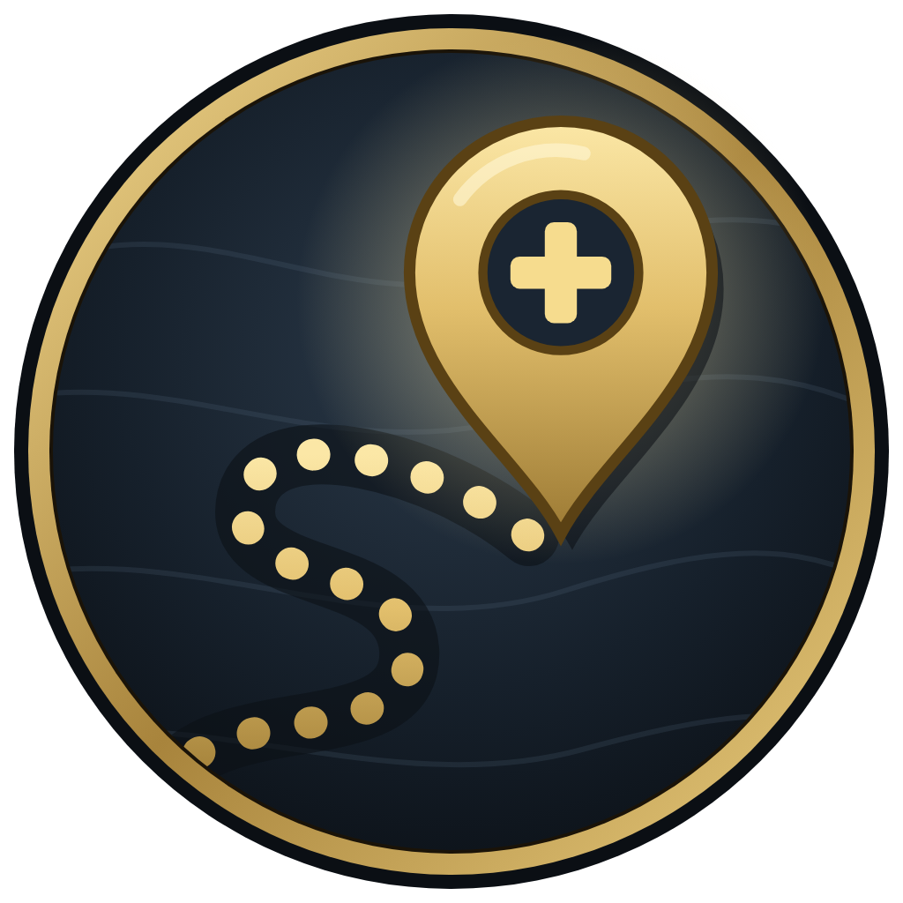

# Waypath+

An all-in-one leveling companion for World of Warcraft: Forever (Horde): your route with an arrow, a quest tracker, travel tips, gear upgrades, a 2nd spec, professions, fishing and gold.

> **Beta.** Works on English game clients (enUS/enGB). Found a bug? Type `/wp errors`, copy the text and post it on the [issue tracker](https://github.com/nickflanders321-tech/RetGear/issues).

**What's covered:**
- **Questing, for every Horde race and class:** Orc, Troll, Tauren, Undead and Skyborne each get their own starting zones (Valley of Trials and Durotar; Camp Narache and Mulgore; Deathknell, Brill and Silverpine; Zephras Isle), then the shared Horde route to 60 with travel tips from their home city. Starting-zone steps are built from WoW Forever's quest data, stop by stop, and tick themselves off. Every class sees its own class quests (including Forever's new ones, like the Forsaken paladin chain, Orc mages and Troll warlocks) on the tracker, and each dungeon lists the quests that race and class can take.
- **Gear, for every class:** each class has its own stat weights and gear guide (Arms Warrior, Beast Mastery Hunter, Combat Rogue, Shadow Priest, Enhancement Shaman, Frost Mage, Affliction Warlock, Feral Druid, Retribution Paladin), limited to the armor and weapons it can use. Tooltips, upgrade pop-ups, bag arrows, quest reward picks and each dungeon's "drops for you" all use it.
- **2nd spec, for every class and spec:** pick any spec as your 2nd and get its gear list, tooltip scores and a one-click gear swap.
- **Professions, all twelve:** Mining, Herbalism, Skinning, Blacksmithing, Engineering, Alchemy, Leatherworking, Tailoring, Enchanting, Cooking, Fishing and First Aid each have a 1-300 plan (WoW Forever's beta routes, Classic routes where Forever's aren't out yet), the closest trainer for your race and every rank's trainer after that, their camp objects, and gold tips. Herbs get the same "node nearby" alerts as ore, and both use WoW Forever's spawn data for where to gather.

## Install
Install from CurseForge (pick WoW Forever), or copy the `Waypath` folder into `World of Warcraft\_forever_\Interface\AddOns\`, then restart the game. Type `/wp` (or `/waypath`) or click the minimap button.

## First launch
A six-page **setup wizard** asks how much help you want (Full guidance, Balanced or Minimal), which professions you'll level, and which automation and extras to turn on. Run it again with `/wp setup` or from Settings.

## On your screen
- **Tracker** (right side): your quests grouped by zone (the zone you're in first), one line each with their level (in the game's colors), progress and distance; new quests nearby; your route tasks; the next dungeon's quests to pick up; your next gear upgrade; and the most important reminders. Click a quest to open it in your quest log, double-click it to turn the arrow to it on or off, right-click to show it on the map, and click a section header to fold it. Drag it anywhere (or lock it in Settings), Ctrl + mouse wheel over it to resize, Shift + mouse wheel to make it wider or narrower; right-click the minimap button to hide it. With two or more quests ready, a **Turn-in run** line sends the arrow to each turn-in in turn, nearest first.
- **Quest bar**: click to target the quest mobs you still need, and use quest items in one click. The `WaypathTarget` macro does the same from a key.
- **Tooltips**: an upgrade score for your spec on every item (and whether it's an upgrade), a score for your **2nd spec** (Holy, Protection, Restoration, any spec you pick), and a gold coin line when an item sells for more on the AH than at a vendor.
- **Fishing panel** (tracker): while you hold a fishing pole, your skill and catches per point, whether fish get away in this zone, your lure timer, fish per hour this session, and raw fish to cook.
- **Immersive fishing**: cast Fishing and the interface fades away, leaving a Cast button and a small display with your skill, a cast timer, your catches and whispers. Move, press Esc or Enter, or stop casting to bring it back (`/wp fishmode` turns it off).
- **Bag icons**: a green arrow on items that are upgrades for you, your 2nd spec's icon on pieces for your 2nd set.
- **Pop-ups**: Equip button for upgrades, level-up banner, "keep for the AH" and "Buy back" warnings at vendors.
- **Ore alerts**: a heads-up when you walk near a spot where a vein you can mine (and that still gives skill) spawns, with direction and distance.
- **Cards:** a tab with a collectible card game built from the world: items, NPCs and places drop into packs (free during the beta), every card has its own art, and The Arena lets you duel the computer with the cards you own. `/wp cards` opens your collection, `/wp arena` the duel.
- **Flight paths**: a tab listing every flight master for your faction (learned or not, nearest first); click one and the arrow guides you there.
- **Travel tips**: when the guide sends you to another zone, the quickest way there with your hearthstone, known flight paths, zeppelins and boats.
- **Arrow and map pins**: the arrow follows your next route step on its own (it never overrides a pin you placed). Double-click the arrow, or right-click it, to turn it off; the arrow switch in the tracker's header turns it on or off for good. Right-click any step, or click a quest giver, dungeon or trainer, to pin it. 74 route steps, 45 quest givers, 56 dungeon entrances and the Fishing/Cooking trainers have WoW Forever coordinates from QuestieDB. `/wp way 45 60` pins any spot.

## Done for you
- Quests are **accepted and turned in automatically** (hold **Shift** to pause). The best reward is picked: your upgrade, or the best vendor value. When an upgrade for you and one for your 2nd spec compete, you choose.
- **Route steps tick themselves** from your quest log, flight paths, hearthstone, professions and spells.
- **Bags sorted** with one click: the Sort button on your bags and bank.
- **Junk is sold and gear repaired** at vendors, but anything worth more on the AH is kept.
- **AH prices** are checked every time you open the Auction House (Auctionator and TSM prices are used too).
- **Dual-spec gear swap**: switch to your 2nd spec and Waypath+ offers to put on its set; switch back and it re-equips your main gear (also a Swap row on the 2nd Spec tab).
- **In a party**: reminders for un-blessed party members and a missing Aura, center-screen alerts when someone needs Purify/Cleanse or is about to die, and a report after every dungeon run.

## The window (`/wp`)
Styled like the classic WoW interface: the stone-and-gold dialog frame, Character-window tabs along the bottom, tooltip-bordered rows and the purple XP bar (blue while rested). A- / A+ change the text size.

| Tab | What's in it |
|---|---|
| **Route** | Undead Horde path from Deathknell to 60 in four foldable sections: **Now** (your zones and dungeons, with only the steps left to do), **Coming up** (next 5 levels), **Later** and **Done**. Dungeon quests to collect, flight paths, travel, paladin milestones, buy-and-mail quests, camping/fishing steps, and your leveling pace |
| **Gear guide** | About 160 Ret upgrades for every slot, levels 8-60: Horde quest rewards, dungeon boss drops, vendors and your own Blacksmithing crafts, grouped by slot near your level |
| **My gear** | Gear check (your 8 best upgrades from the guide vs what you wear, and the dungeons with the most upgrades for you), score per slot, hit % vs cap, next upgrade for each slot, pre-raid checklist. Click an item to see the dungeon and boss that drop it, or the quest (who starts it, where, at what level), with a map button |
| **Group** | Solo vs grouped XP/hr, your paladin duties (who needs a Blessing, Aura), shared quests with a Share click, LFG posts for the right dungeon or group quest, and dungeon run reports |
| **2nd Spec** | Pick any spec of your class (all 28: tanks, healers and damage). **Spec**: its stats, how to play it and what's new in Forever. **Gear to collect**: your best piece per slot for it (worn, bags, bank), and what to hunt for from level 30, by dungeon. Dual spec unlocks at 40; your 2nd set is never sold |
| **Professions** → *Professions* | Every profession's 1-300 route (WoW Forever guides). For each of yours: where you are, how many crafts are left in the step, **how many more of each material you need** (bags and bank counted, plus what crafted reagents like bolts and bars take), and **where to go**: the best herb and ore clusters, beasts to skin and fishing pools for your skill, the mobs, nodes and vendors for what you're short of, and your next trainer. **Double-click a place and the arrow takes you there.** Opening a profession window reads its exact recipes. Also smelt-or-sell, smithing upgrades and material prices |
| **Professions** → *Fishing & cooking* | Your Fishing and Cooking skill, next rank and how to get it, whether every fish bites in your zone, where to fish for your skill (Horde), raw fish in your bags that still level Cooking, fish to catch and cook (recipes, day/night and seasonal fish), poles, lures and gear you own, the Stranglethorn Fishing Extravaganza, **everything fishing can bring up** (every fish, chest, clam and pool: chance per catch, which zones and pools, the skill it starts at, what containers hold, click a pool to pin it), and your catch history |
| **Professions** → *Camping* | Camp Benefits timer, which object to place (Sharpening Wheel vs Fish Bowl from your stats), campfires and camp objects, and the camping and cooking steps along your route |
| **Gold & AH** → *Sell & prices* | Your bag items to sell on the AH, plus tracked gear and materials with live prices |
| **Gold & AH** → *Gold tips* | Gold-making tips for your level with live prices (refreshed weekly) |
| **Gold & AH** → *Bank alt* | Quests you can skip farming for: what to buy and mail, with a shopping list for your bank alt |
| **Settings** | Every helper, grouped, on or off |

## Characters: profiles and bank alts
Every character has its **own profile**: its own settings, route progress, quests, flight paths, professions plan, stat weights and 2nd spec set. Auction House prices, price alerts and window positions are shared by the whole account. The first time a new character logs in with Waypath+, it asks: **New profile** (the full leveling guide, starting fresh with the setup wizard) or **Bank alt**. Settings → *This character* switches between the two, makes a character your main, or starts a character over with a brand new profile (`/wp char profile`, `/wp char alt`, `/wp char reset`).

## Bank alt
No bank alt yet? Make a new Undead on the same realm, log in and pick **Bank alt**: a secret guide on the tracker walks it to the Undercity Auction House, bank and mailbox with the arrow (`/wp bankalt` shows it on your main too).

Your **main** is the character your bank alts buy for (the first character with a profile, or whichever you pick with `/wp main`). A bank alt's tracker shows the shopping list, clicking an item searches the AH, and a button at the mailbox attaches everything and addresses it to your main. `/wp main` changes which character is your main.

## Key bindings
Esc > Options > Keybindings > AddOns > Waypath+: open the guide, pin your nearest objective, arrow on/off, show/hide the tracker, undo a tick, sort bags. Minimap button: click opens the guide, right-click hides the tracker, Shift-click toggles the arrow, Ctrl-click opens Settings.

## Commands
| Command | What it does |
|---|---|
| `/wp` | Open or close the window |
| `/wp group` · `/wp lfg Scarlet Monastery` | Group tab · post an LFG message |
| `/wp spec` · `/wp heal` (2nd spec gear) · `/wp fish` · `/wp camp` · `/wp gold` · `/wp mail` · `/wp settings` | Open that tab |
| `/wp fp` · `/wp fp list` | Arrow to the nearest flight path you have not learned · open the Flight paths tab |
| `/wp auto` | Auto accept / turn in on or off |
| `/wp next` | Point the arrow at your current objective; press again to skip to the next stop |
| `/wp plan` · `/wp plan chat` | Open the Quest plan tab · print the planned stops in chat |
| `/wp near` · `/wp near go` | What is worth doing close by (rated) · arrow to the first |
| `/wp why` | Why the guide chose this objective, and what it needs (ticked live) |
| `/wp goto 45 60 Name` · `goto pin` · `goto list` · `goto done` · `goto clear` | Your own goals, followed one at a time (works in zones with no quest data) |
| `/wp minimal` | Tracker with only the Now line (again to bring everything back) |
| `/wp share` | Share your current objective with your party (and see theirs) |
| `/wp log` · `log copy` · `log clear` | Play-test log: arrivals, skipped stops, pins you set yourself |
| `/wp undo` | Put the last task you ticked off back on the list (the tracker also shows an Undo line for 10 minutes) |
| `/wp way 45 60` | Pin a spot in your zone and follow the arrow |
| `/wp pace` | Time at this level, last level and your average |
| `/wp talents` · `/wp talents check` | Open the game's talent screen · show how unspent talent points are read on this client (for bug reports) |
| `/wp sort` · `/wp sort bank` | Sort your bags or bank (also the Sort button on your bags) |
| `/wp session` | XP, quests, ore and gold this session |
| `/wp profit` | Bag items to sell on the AH; `/wp profit min 25` sets the threshold in silver; `/wp profit ignore [item]` stops flagging an item |
| `/wp track [item]` · `/wp untrack [item]` | Watch an item's AH price |
| `/wp alert [item] 25` | Tell me when it's listed for 25 gold or less |
| `/wp scan` · `/wp autoscan` | Re-check prices at the AH · turn the automatic scan on or off |
| `/wp weight STR 2.5` · `/wp hitcap 9` · `/wp talenthit 3` · `/wp reset` | Tune your upgrade score |
| `/wp turnin` | Start or stop a turn-in run (the arrow chains through your ready quests) |
| `/wp greys` | Abandon unfinished grey quests (asks first) |
| `/wp news` | What changed in the update you're running |
| `/wp where <item>` | Where an item on your gear lists drops, or which quest gives it |
| `/wp gear 2` · `/wp gear 1` | Equip your 2nd spec's set / put your main gear back on |
| `/wp spec holy` (any spec name) | Make that spec your 2nd spec |
| `/wp errors` · `/wp errors clear` | Waypath+'s caught errors, in a window you can copy from · clear them |
| `/wp setup` | Run the setup wizard again |
| `/wp tracker` · `/wp tooltip` | Show or hide the tracker / tooltip line / welcome screen |
| `/wp main` | Make this character your main (the one bank alts buy for) |
| `/wp char profile` · `/wp char alt` · `/wp char reset` | Give this character its own profile, make it a bank alt, or start it over with a brand new profile |

## Keeping it current
Twice a week (Monday and Thursday mornings), an automatic update checks the newest WoW Forever guides and refreshes the quest route, gear guide, gold tips, 2nd spec builds and gear, bank-alt quests and camping/fishing data. It also rebuilds the map waypoints, quest objectives and the gear guide from the latest WoW Forever data, so changes Blizzard makes show up even before guides catch up. Each release is listed in `CHANGELOG.md`.

Gear guide items are scored from the cMaNGOS classic item database and checked against WoW Forever's item data (`tools/gear`). Waypoints, quest objectives, starting-zone steps and dungeon quests come from [QuestieDB](https://github.com/Questie/QuestieDB)'s merged WoW Forever data (`tools/qdb`); `tools/waypoints`, `tools/objectives` and `tools/routes` rebuild them. Data sources include Icy Veins, Wowhead, Warcraft Tavern, Mobalytics, wow-professions.com and Warcraft Wiki. Several dungeon drops are Classic-era until Forever's loot tables are confirmed.

## Reporting bugs
Waypath+ catches its own errors instead of interrupting you. Type `/wp errors` to see them in a window you can copy from, and post them with your race, class and level on the [issue tracker](https://github.com/nickflanders321-tech/RetGear/issues).

## Language
Quest, zone, profession and spell names are matched in English, so Waypath+ is made for English game clients (enUS/enGB). On other clients it says so once at login; route steps, quests and professions may not be recognized there.

## License and credits
Waypath+ is free software under the GNU General Public License v3 (see `LICENSE`).
- Quest, objective and spawn data: [QuestieDB](https://github.com/Questie/QuestieDB) (GPL-3.0), WoW Forever data merged by the Questie team.
- Item stats: [cMaNGOS classic-db](https://github.com/cmangos/classic-db) (GPL-3.0).
- Guides and research: Icy Veins, Wowhead, Warcraft Tavern, Mobalytics, wow-professions.com, wowtbc.gg and Warcraft Wiki.

